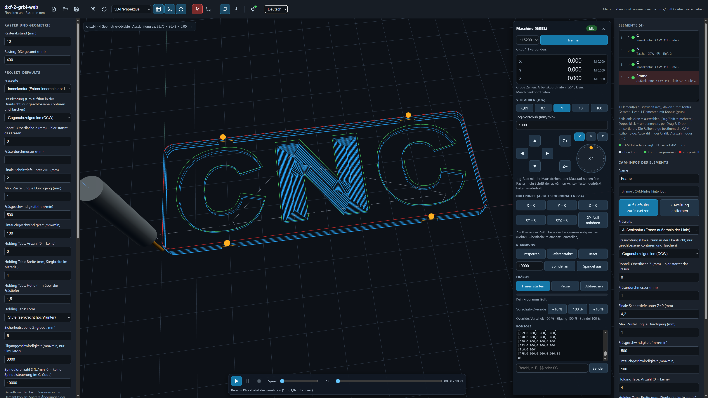
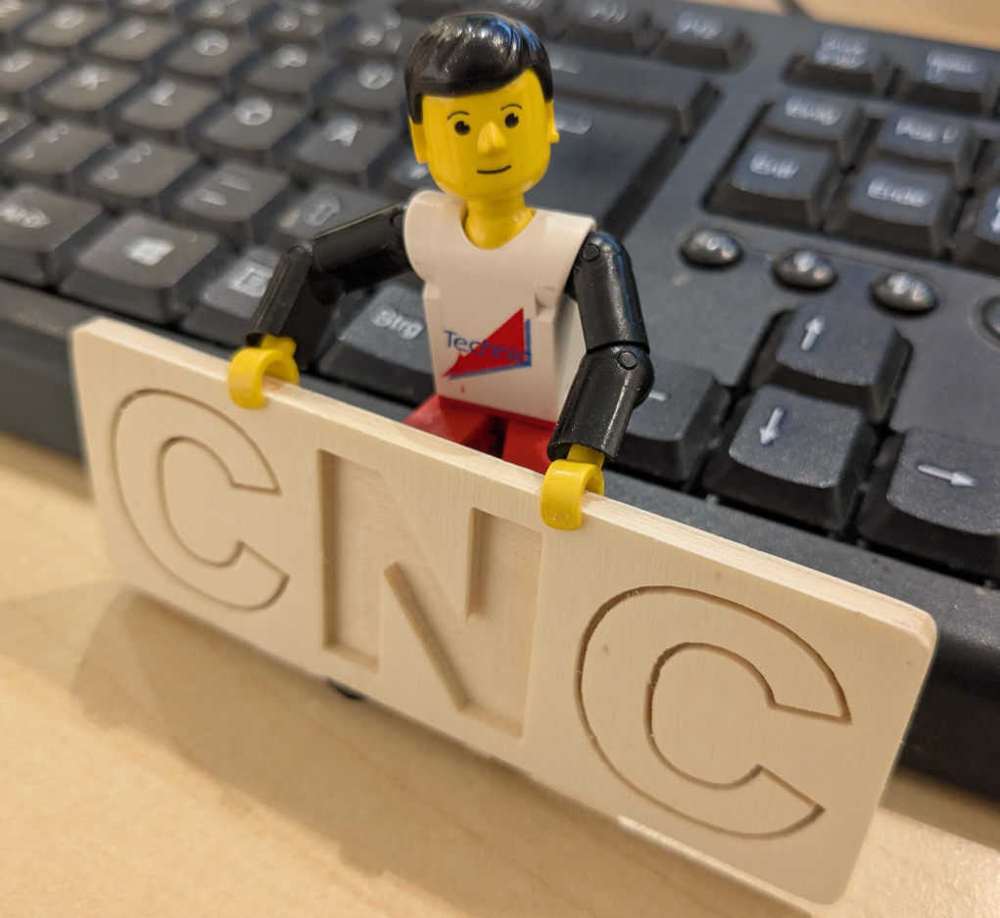

# dxf-2-grbl-web

**Von der DXF-Zeichnung zum gefrästen Teil – komplett im Browser.**

dxf-2-grbl-web ist eine Web-App in einer einzigen Datei (`dxf-2-grbl-web.html`). Sie wandelt 2D-DXF-Zeichnungen in G-Code für [GRBL](https://github.com/grbl/grbl)-Fräsen um, zeigt und simuliert das Ergebnis in 3D und kann den Job direkt per USB an die Maschine senden. Keine Installation, kein Build, kein Server.

*[English version → README.md](README.md)*

---

## ⚠️ Zu 100 % gevibecoded – bitte lesen

**Jede einzelne Zeile dieses Projekts wurde von einem KI-Assistenten ([Claude](https://www.anthropic.com/claude) von Anthropic) aus Beschreibungen in natürlicher Sprache geschrieben. Es wurde kein Code von Hand geschrieben oder durchgesehen.** Genau das bedeutet hier „Vibe Coding“: beschreiben, was man will, ausprobieren, Änderungen anfordern, wiederholen.

Was das für dich heißt:

- Der Code wurde mit automatisierten Tests geprüft (Fräsbahn-Logik, G-Code-Erzeugung, GRBL-Übertragung gegen einen Emulator), **aber nicht in einem formalen Review und nicht an einer breiten Auswahl echter Maschinen**.
- **Eine CNC-Fräse kann dich verletzen und Maschine und Werkstück zerstören.** Prüfe die Fräsbahnen immer im eingebauten Simulator, mache einen Trockenlauf mit ausgeschalteter Spindel und Z weit über dem Werkstück, halte die Hand am Not-Aus und kontrolliere Nullpunkte, Werkzeug und Maschineneinstellungen selbst.
- Die Nutzung erfolgt **auf eigenes Risiko**. Es gibt keine Gewährleistung (siehe [Lizenz](#lizenz)).
- Dieses Projekt wird so bereitgestellt, wie es ist. Forks sind willkommen: Macht gern damit weiter! Pull Requests und Issues werde ich nicht bearbeiten.

---

## Getestete Konfigurationen

| Firmware | Maschine | Getestet von | Status |
|---|---|---|---|
| GRBL 1.1h (`[VER:1.1h.20190825:]`) | Selbstgebaute CNC-Fräse des Autors | Autor | Läuft ohne bekannte Probleme (Verbinden, Jog, Nullen, Simulation, Fräsen von Konturen/Taschen/Holding Tabs) |

---

## Was es macht

1. **DXF-Datei öffnen** – sie wird lokal im Browser verarbeitet und nie hochgeladen.
2. **Aufräumen passiert automatisch** – doppelte Elemente werden entfernt, Linienstücke mit Enden unter 0,2 mm Abstand werden zu Konturen verbunden.
3. **Fräsparameter pro Element zuweisen** – Außenkontur, Innenkontur oder Tasche, Tiefen, Vorschübe, Holding Tabs, … mit Defaults für das ganze Projekt.
4. **Fräsbahnen werden bei jeder Änderung neu berechnet** und in der 3D-Ansicht angezeigt.
5. Den Job in Echtzeit **simulieren**, inklusive Materialabtrag.
6. **G-Code exportieren** oder **mit einer GRBL-Maschine verbinden**, verfahren, Nullpunkt setzen und fräsen – mit dem Fräser live in der 3D-Ansicht.

---

## Funktionen

### DXF-Import und Aufräumen
- Unterstützte Elemente: `LINE`, `LWPOLYLINE`, `POLYLINE` (auch Bulge-Bögen), `CIRCLE`, `ARC`, `ELLIPSE`, `SPLINE`, `POINT` und Blöcke (`INSERT`, verschachtelt, mit Skalierung und Drehung)
- Nicht unterstützte Elemente (z. B. Text, Schraffuren) werden gemeldet und ignoriert
- Automatisches **Entfernen von Duplikaten** – erkannt unabhängig von Startpunkt und Zeichenrichtung
- Automatisches **Verbinden** von Elementen, deren Enden weniger als 0,2 mm auseinanderliegen, zu einem Element; geschlossene Schleifen werden erkannt. Verbunden wird nur dort, wo genau zwei Enden zusammentreffen – Verzweigungen und Kreuzungen bleiben unangetastet
- Funktioniert auch bei Dateien aus vielen winzigen Linienstücken (zerlegte Bögen und Polylinien)

### 3D-Ansicht und Auswahl
- Drehen, Zoomen, Verschieben; Kameravoreinstellungen (3D, Draufsicht, Vorderansicht, Seitenansicht); alles einpassen und Ansicht zurücksetzen
- Raster, Achsen und Geometrie ein-/ausblenden; Rasterabstand und -größe einstellbar
- Auswahlmodus: Klick, Auswahlrechteck, mit Strg/Shift erweitern; **Esc schaltet den Auswahlmodus um**
- Ausgewählte Elemente sind rot, Elemente mit Fräsparametern grün, alle anderen bleiben hell

### Elementliste
- Jedes DXF-Element ist aufgelistet und lässt sich **umbenennen** (Doppelklick)
- Markierung zeigt, ob CAM-Infos hinterlegt sind, dazu eine kurze Parameterübersicht
- **Per Drag & Drop umsortieren** – die Reihenfolge bestimmt die Fräsreihenfolge (Mehrfachauswahl wird als Block verschoben)
- Klick, Strg/Shift-Mehrfachauswahl, synchron mit der 3D-Ansicht

### CAM – Fräsparameter (pro Element, mit Projekt-Defaults)
- **Frässeite:** Außenkontur, Innenkontur oder **Tasche**
- **Fräsrichtung:** CW oder CCW, unabhängig von der Punktreihenfolge im DXF (geschlossene Konturen und Taschen)
- Rohteil-Oberfläche Z (hier startet das Fräsen), Fräserdurchmesser, finale Tiefe, maximale Zustellung je Durchgang, Fräs- und Eintauchvorschub
- Globale Sicherheitsebene; die Rohteil-Oberfläche wird dagegen geprüft
- Optionale Spindeldrehzahl (`M3 S…` mit Anlaufzeit, `M5` am Ende und bei Werkzeugwechseln)
- Parameter lassen sich für mehrere ausgewählte Elemente gleichzeitig ändern (uneinheitliche Werte werden angezeigt)
- Default-Parameter für das Projekt, jedem Element zuweisbar

### Fräsbahn-Berechnung
- Konturversatz für Außen-/Innenfräsen mit dem echten Fräserradius
- Robuster Versatz mit [Clipper](https://sourceforge.net/projects/jsclipper/) für Innenkonturen und Taschen
- **Fehlermeldung, wenn der Fräser zu breit ist** – auch bei Engstellen, die der Fräser nicht erreichen könnte
- **Taschen:** konzentrische Bahnen von innen nach außen, einstellbare seitliche Zustellung, auf Tiefe verbunden, wo es sicher ist
- **Inseln in Taschen:** Geschlossene Konturen, die komplett innerhalb einer Tasche liegen (auch solche ohne Fräsparameter), bleiben automatisch stehen; der Fräser hält seinen Radius Abstand. Pro Tasche abschaltbar („Inseln stehen lassen“); weitere Taschen innerhalb einer Tasche gelten als tiefere Taschen, nicht als Inseln
- Mehrere Durchgänge mit direktem Zustellen auf die nächste Tiefe (kein unnötiger Rückzug bei geschlossenen Konturen; Taschen wechseln pro Ebene die Bahnreihenfolge)
- Offene Linien: innen = links, außen = rechts der Zeichenrichtung
- Fräsbahnen werden **bei jeder Änderung automatisch neu berechnet**; per Knopf ein-/ausblendbar
- Werkzeugwechsel: Der G-Code pausiert (`M0`), wenn sich der Fräserdurchmesser ändert

### Holding Tabs
- Anzahl, Breite und Höhe pro Kontur
- **Automatische Verteilung, bevorzugt auf geraden Abschnitten**
- Formen: **Stufe** oder **Rampe** (Rampenwinkel einstellbar)
- **Tabs mit der Maus entlang der Kontur verschieben** (orange Kugeln ziehen); mit einem Klick zurück zur automatischen Verteilung
- Die Tab-Breite ist die im Material verbleibende Stegbreite (der Fräserdurchmesser wird berücksichtigt)

### Simulator
- **Play / Pause / Stop**, Fortschrittsbalken zum Springen an jede Stelle
- **Geschwindigkeit 0,5×–50× in 0,5er-Schritten; 1,0× ist Echtzeit** (nach Vorschüben und einem einstellbaren Eilgang)
- 3D-Modell des Fräsers mit dem richtigen Durchmesser
- **Materialabtrag** wird auf das Rohteil gemalt, nach Tiefe schattiert
- Bereits abgefahrene Schnittwege werden grau
- Die Simulation hält bei Werkzeugwechseln an

### G-Code-Export
- GRBL-kompatibler G-Code (`G0`/`G1`, `G21`, `G90`, `G17`, `G94`, `G54`, `M3`/`M5`, `G4`, `M0`, `M30`)
- Rampen-Tabs nutzen schräge `G1`-Bewegungen
- Kommentare sind immer einfaches englisches ASCII

### Maschinensteuerung (GRBL über USB)
- Verbindung direkt über die **Web-Serial-API** (Chrome / Edge), GRBL 1.1 und 0.9
- Live-**Arbeits- und Maschinenposition**, Maschinenzustand (Idle, Run, Hold, Alarm, …)
- **Jog-Rad** (mit der Maus drehen oder Mausrad), Pfeiltasten mit Wiederholung bei gedrückter Taste, Schrittweiten von 0,01 bis 100 mm, Jog-Vorschub
- **Achsen nullen** (X, Y, Z, XY, XYZ) über G54, XY-Null anfahren (Z wird vorher angehoben)
- Entsperren (`$X`), Referenzfahrt (`$H`), Soft-Reset, Spindel an/aus, Vorschub-Override
- **Job fräsen:** gepufferte Übertragung mit GRBL-Zeichenzählung, Pause / Fortsetzen / Abbrechen (erst anhalten, dann Reset)
- **Werkzeugwechsel-Dialog:** Die Maschine hält an, du kannst verfahren und Z neu nullen und dann fortfahren
- Fehler- und Alarmcodes im Klartext, Konsole für manuelle Befehle
- Sicherheitsabfrage vor jedem Job
- **Der Fräser wird live in der 3D-Ansicht gezeigt**, beim Verfahren und beim Fräsen, mit Materialabtrag und grauen abgefahrenen Wegen – wie im Simulator

### Projekte
- Das gesamte Projekt als JSON-Datei speichern/öffnen (`*.dxfcam.json`): DXF-Quelle, alle Parameter, Namen, Reihenfolge, Tab-Positionen, Sprache

### Oberfläche und Sprachen
- **Deutsch und Englisch**, zur Laufzeit umschaltbar; die Wahl wird in der Projektdatei gespeichert
- Weitere Sprachen sind leicht ergänzt: einen Block im Quelltext kopieren und übersetzen (siehe [Sprache hinzufügen](#sprache-hinzufügen))
- Rote Fehlermeldungen als Popup, damit nichts übersehen wird; Tooltips und Icons überall
- Aufteilung in ein linkes Panel (Raster, Defaults, CAM-Status), die 3D-Ansicht und ein rechtes Panel (Elementliste und CAM-Infos)

---

## Loslegen

### Voraussetzungen
- Ein moderner Desktop-Browser. Für die Maschinensteuerung (Web Serial) wird **Chrome oder Edge** benötigt. Alles andere läuft auch in Firefox und Safari.
- Eine Internetverbindung beim Laden der Seite: three.js, dxf-parser und Clipper werden von [esm.sh](https://esm.sh) geholt (sie sind nicht eingebunden).
- Für die Maschinensteuerung: eine per USB angeschlossene GRBL-Steuerung (Baudrate meist 115200)

### Starten
- **Lokal:** `dxf-2-grbl-web.html` in Chrome oder Edge öffnen

### Typischer Ablauf
1. DXF-Datei öffnen (Toolbar → *DXF öffnen*).
2. Auswahlmodus aktivieren, eine Kontur auswählen (oder in der Elementliste anklicken), **Defaults zuweisen** klicken und die Parameter anpassen.
3. Fräsbahnen in der 3D-Ansicht prüfen und den **Simulator** laufen lassen.
4. Entweder den G-Code exportieren oder das **Maschinen-Panel** öffnen, verbinden, ans Werkstück fahren, den Nullpunkt setzen (Z = 0 muss zum Programm passen) und fräsen.

### Maus und Tasten
| Aktion | Bedienung |
|---|---|
| Drehen / Zoomen / Verschieben | Linke Maustaste ziehen / Mausrad / rechte Maustaste oder Shift + ziehen |
| Auswahlmodus umschalten | Toolbar-Knopf oder `Esc` |
| Zur Auswahl hinzufügen | `Strg` / `Shift` + Klick oder Auswahlrechteck |
| Element umbenennen | Doppelklick in der Liste |
| Holding Tab verschieben | Orange Kugel ziehen |

---

## Einschränkungen

- Nur 2,5D-Fräsen (keine 3D-Flächen); nur GRBL; geht von Millimetern und dem Nullpunktversatz G54 aus
- Bahnen werden als viele kurze `G1`-Bewegungen ausgegeben (keine `G2`/`G3`-Bögen), die Dateien können daher groß werden
- Keine Fräserradiuskorrektur in der Steuerung (`G41`/`G42`) – die Korrektur wird in der App berechnet
- Elemente mit unterschiedlichen Parametern werden nie zu einer Kontur zusammengefasst
- Nicht jeder DXF-Elementtyp wird unterstützt (siehe oben)

---

## Sprache hinzufügen

Alle Texte stehen in einer Tabelle am Anfang von `dxf-2-grbl-web.html`:

1. Den Block `I18N.en = { ... }` kopieren und den Code ändern, z. B. `I18N.fr = { ... }`.
2. Die Werte übersetzen, auch `lang.name` (der Name im Sprachmenü). Platzhalter wie `{name}` unverändert lassen.
3. Fehlende Schlüssel fallen automatisch auf Englisch zurück.

Sprachmenü, automatische Erkennung der Browsersprache und Projektdatei übernehmen die neue Sprache von selbst.

---

## Verwendete Bausteine

- [three.js](https://threejs.org/) – 3D-Darstellung (MIT)
- [dxf-parser](https://github.com/gdsestimating/dxf-parser) – DXF lesen (MIT)
- [Clipper (JS-Port)](https://sourceforge.net/projects/jsclipper/) – Polygon-Versatz (Boost Software License 1.0)
- [GRBL](https://github.com/grbl/grbl) – die Firmware, mit der die App spricht (nicht enthalten; die App nutzt nur ihr serielles Protokoll)

---

## Lizenz

Der eigene Code des Projekts steht unter der **MIT-Lizenz**. Die oben genannten Bibliotheken werden zur Laufzeit von esm.sh geladen und behalten ihre eigenen Lizenzen.
