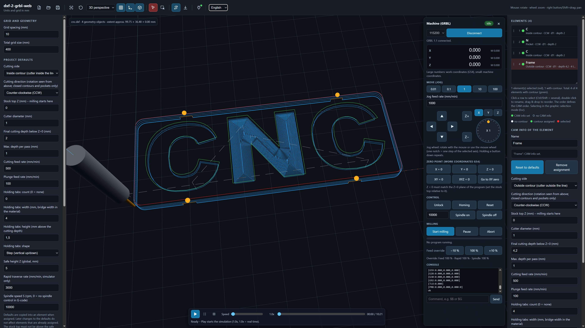

# dxf-2-grbl-web

**From DXF drawing to milled part – entirely in your browser.**

dxf-2-grbl-web is a single-file web app (`dxf-2-grbl-web.html`) that turns 2D DXF drawings into G-code for [GRBL](https://github.com/grbl/grbl) CNC mills, lets you preview and simulate the result in 3D, and can send the job straight to your machine over USB. No installation, no build step, no server.

*[Deutsche Version → README.de.md](README.de.md)*

---

## ⚠️ 100 % vibe-coded – please read

**Every single line of this project was written by an AI assistant ([Claude](https://www.anthropic.com/claude) by Anthropic) from natural-language prompts. No code was written or reviewed by hand.** That is what "vibe coding" means here: describe what you want, test it, ask for changes, repeat.

What this means for you:

- The code has been checked with automated tests (toolpath logic, G-code generation, GRBL streaming against an emulator), **not with a formal review or on a wide range of real machines**. 
- **A CNC mill can injure you and destroy your machine and workpiece.** Always check the toolpaths in the built-in simulator, do a dry run with the spindle off and the Z axis well above the workpiece, keep your hand on the emergency stop, and verify zero points, tool and machine settings yourself.
- Use it **at your own risk**. There is no warranty (see [License](#license)).
- This project is provided as is. Forks are welcome: feel free to take it further! I will not review pull requests or issues.

---
## Tested setups

| Firmware | Machine | Tested by | Status |
|---|---|---|---|
| GRBL 1.1h (`[VER:1.1h.20190825:]`) | Author's DIY CNC mill | Autor | Runs without known issues (connect, jog, zero, simulate, mill contours/pockets/holding tabs) |

---

## What it does

1. **Open a DXF file** – it is processed locally in your browser and never uploaded.
2. **Clean-up happens automatically** – duplicate entities are removed and line segments whose ends are within 0.2 mm are joined into contours.
3. **Assign milling parameters per element** – outside contour, inside contour or pocket, depths, feeds, holding tabs, … with project-wide defaults.
4. **Toolpaths are recalculated on every change** and shown in the 3D view.
5. **Simulate** the job in real time, including material removal.
6. **Export G-code** or **connect to a GRBL machine**, jog, set zero, and mill – with the tool shown live in the 3D view.

---

## Features

### DXF import & clean-up
- Supported entities: `LINE`, `LWPOLYLINE`, `POLYLINE` (including bulge arcs), `CIRCLE`, `ARC`, `ELLIPSE`, `SPLINE`, `POINT`, and blocks (`INSERT`, nested, with scale and rotation)
- Unsupported entities (e.g. text, hatches) are reported and ignored
- Automatic **duplicate removal** – detected regardless of start point or drawing direction
- Automatic **joining** of elements whose ends are closer than 0.2 mm into one element; closed loops are detected. Joining only happens where exactly two ends meet, so junctions and crossings are left alone
- Works for files built from many tiny line segments (exploded arcs and polylines)

### 3D view & selection
- Orbit, zoom, pan; camera presets (3D, top, front, side); fit-all and reset view
- Toggle grid, axes and geometry; configurable grid spacing and size
- Selection mode: click, rubber-band selection, add with Ctrl/Shift; **Esc toggles the selection mode**
- Selected elements are red, elements with milling parameters are green, others stay light

### Element list
- Every DXF element is listed and can be **renamed** (double-click)
- Marker shows whether CAM info is assigned, with a short parameter summary
- **Drag & drop to reorder** – the order defines the milling order (multi-selection moves as a block)
- Click, Ctrl/Shift multi-select, synchronized with the 3D view

### CAM – milling parameters (per element, with project defaults)
- **Cutting side:** outside contour, inside contour, or **pocket**
- **Cutting direction:** CW or CCW, independent of the point order in the DXF (closed contours and pockets)
- Stock top Z (where milling starts), cutter diameter, final depth, max. depth per pass, cutting feed, plunge feed
- Global safe height; the stock top is validated against it
- Optional spindle speed (`M3 S…` with spin-up dwell, `M5` at the end and at tool changes)
- Parameters can be edited for several selected elements at once ("mixed" values are shown)
- Default parameters for the project, assignable to any element

### Toolpath generation
- Contour offsets for outside/inside milling with the real cutter radius
- Robust offsetting with [Clipper](https://sourceforge.net/projects/jsclipper/) for inside contours and pockets
- **Errors if the cutter is too wide** for a contour or pocket – including narrow spots that the cutter could not reach
- **Pockets:** concentric paths from the inside out, adjustable stepover, linked at depth where safe
- **Islands in pockets:** closed contours lying completely inside a pocket (also ones without milling parameters) are left standing automatically; the cutter keeps its radius away from them. Switchable per pocket ("Leave islands standing"); other pockets inside a pocket count as deeper pockets, not as islands
- Multiple passes with direct plunging between depths (no needless retract on closed contours; pockets alternate their path order per level)
- Open lines: inside = left, outside = right of the drawing direction
- Toolpaths are **recalculated automatically** on every change; show/hide them with one button
- Tool change handling: the G-code pauses (`M0`) when the cutter diameter changes

### Holding tabs
- Count, width and height per contour
- **Automatic distribution, preferably on straight sections**
- Shapes: **step** or **ramp** (adjustable ramp angle)
- **Move tabs with the mouse** along the contour (drag the orange spheres); reset to automatic distribution with one click
- Tab width is the bridge width left in the material (cutter diameter is accounted for)

### Simulator
- **Play / Pause / Stop**, progress bar to jump anywhere
- **Speed 0.5×–50× in 0.5 steps; 1.0× is real time** (based on feed rates and a configurable rapid rate)
- 3D model of the cutter with the correct diameter
- **Material removal** is painted onto the stock, shaded by depth
- Already-travelled cutting paths turn grey
- Simulation pauses at tool changes

### G-code export
- GRBL-compatible G-code (`G0`/`G1`, `G21`, `G90`, `G17`, `G94`, `G54`, `M3`/`M5`, `G4`, `M0`, `M30`)
- Ramped holding tabs use slanted `G1` moves
- Comments are always plain English ASCII

### Machine control (GRBL over USB)
- Connects directly via the **Web Serial API** (Chrome / Edge), GRBL 1.1 and 0.9
- Live **work and machine position**, machine state (Idle, Run, Hold, Alarm, …)
- **Jog dial** (rotate with the mouse or use the wheel), arrow buttons with press-and-hold repeat, step sizes from 0.01 to 100 mm, jog feed
- **Zero axes** (X, Y, Z, XY, XYZ) via G54, move to XY zero (raising Z first)
- Unlock (`$X`), homing (`$H`), soft reset, spindle on/off, feed override
- **Run the job**: buffered streaming with GRBL character counting, pause / resume / abort (hold, then reset)
- **Tool change dialog**: the machine stops, you can jog and re-zero Z, then continue
- Error and alarm codes are decoded in plain language; a console for manual commands
- Safety confirmation before every job
- **The tool is shown live in the 3D view** during jogging and milling, including material removal and grey travelled paths – just like in the simulator

### Projects
- Save/open the whole project as a JSON file (`*.dxfcam.json`): DXF source, all parameters, names, order, tab positions, language

### User interface & languages
- **English and German**, switchable at runtime; the choice is stored in the project file
- Easy to add more languages: copy one block in the source and translate it (see [Adding a language](#adding-a-language))
- Red error toasts so problems are never missed; tooltips and icons throughout
- Responsive layout with a left panel (grid, defaults, CAM status), the 3D view, and a right panel (element list and CAM info)

---

## Getting started

### Requirements
- A modern desktop browser. **Chrome or Edge** is required for machine control (Web Serial). Everything else also works in Firefox and Safari.
- An internet connection when the page loads: three.js, dxf-parser and Clipper are fetched from [esm.sh](https://esm.sh). (They are not bundled.)
- For machine control: a GRBL controller connected via USB (baud rate usually 115200)

### Run it
- **Locally:** open `dxf-2-grbl-web.html` in Chrome or Edge

### Typical workflow
1. Open a DXF file (toolbar → *Open DXF*).
2. Enable the selection mode, select a contour (or pick it in the element list), click **Assign defaults** and adjust its parameters.
3. Check the toolpaths in the 3D view and run the **simulator**.
4. Either export the G-code, or open the **machine panel**, connect, jog to the workpiece, set the zero point (and make sure Z = 0 matches your program), and start milling.

### Mouse & keys
| Action | How |
|---|---|
| Rotate / zoom / pan | Left drag / wheel / right drag or Shift + drag |
| Toggle selection mode | Toolbar button or `Esc` |
| Add to selection | `Ctrl` / `Shift` + click or rubber band |
| Rename element | Double-click in the list |
| Move holding tab | Drag the orange sphere |

---

## Limitations

- 2.5D milling only (no 3D surfaces); GRBL only; assumes millimetres and the G54 work offset
- Paths are output as many short `G1` moves (no `G2`/`G3` arcs), so files can be large
- No cutter-radius compensation in the controller (`G41`/`G42`) – compensation is calculated in the app
- Elements that have different parameters are never merged into one contour
- Not every DXF entity type is supported (see above)

---

## Adding a language

All texts live in one table near the top of `dxf-2-grbl-web.html`:

1. Copy the `I18N.en = { ... }` block and change the code, e.g. `I18N.fr = { ... }`.
2. Translate the values, including `lang.name` (the name shown in the language menu). Keep placeholders such as `{name}` unchanged.
3. Missing keys automatically fall back to English.

The language menu, automatic detection of the browser language, and the project file pick up the new language automatically.

---

## Built with

- [three.js](https://threejs.org/) – 3D rendering (MIT)
- [dxf-parser](https://github.com/gdsestimating/dxf-parser) – DXF reading (MIT)
- [Clipper (JS port)](https://sourceforge.net/projects/jsclipper/) – polygon offsetting (Boost Software License 1.0)
- [GRBL](https://github.com/grbl/grbl) – the firmware this app talks to (not included; the app only uses its serial protocol)

---

## License

The project's own code is released under the **MIT License**. The third-party libraries above are loaded at runtime from esm.sh and keep their own licenses.